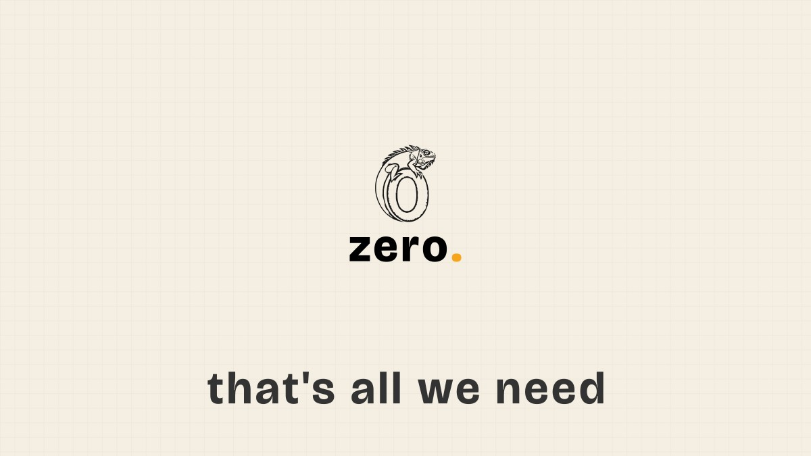

<br/>

<p align="center">
  <table>
    <tr style="background-color: #f8f8f8; text-align: center;">
      <th style="padding: 12px; border: 1px solid #ddd;">Documentation</th>
      <th style="padding: 12px; border: 1px solid #ddd;">DeepWiki</th>
      <th style="padding: 12px; border: 1px solid #ddd;">Coverage</th>
      <th style="padding: 12px; border: 1px solid #ddd;">Stability</th>
      <th style="padding: 12px; border: 1px solid #ddd;">Build Status</th>
    </tr>
    <tr style="text-align: center;">
      <td style="padding: 12px; border: 1px solid #ddd;"><a href="https://zerofmk.in">zerofmk.in</a></td>
      <td style="padding: 12px; border: 1px solid #ddd;"><a href="https://deepwiki.com/im-ng/zero"></a></td>
      <td style="padding: 12px; border: 1px solid #ddd;"></td>
      <td style="padding: 12px; border: 1px solid #ddd;"><a href="https://im-ng.github.io/zero-extended/"></a></td>
      <td style="padding: 12px; border: 1px solid #ddd;"><a href="https://github.com/im-ng/zero/workflows/CI/badge.svg"></a></td>
    </tr>
  </table>
</p>
<br/>

# Zero Framework

**One binary. No GC. Build config-driven microservices in Zig.**

**Zero** is a batteries-included web framework for [Zig](https://ziglang.org). It wires REST, SQL, NoSQL, cache, pub/sub, auth, GraphQL, Protobuf, search, metrics, and tracing into one static binary, and you configure almost everything through `.env`.

- **Zero boilerplate**: Databases, queues, auth and observability plug in with no glue code.
- **One static binary**: ~16 to 65 MiB RSS, no managed runtime, ships anywhere (including Kubernetes).
- **Observable by default**: Structured JSON logs, Prometheus metrics, distributed tracing and health endpoints from the first request.
- **Fast and small**: Tens of thousands of requests/sec at ~50 MiB RSS, no GC pauses, no JIT warm-up.

> [!note]
> Zero is pre-1.0 and releases often as the core API settles. For production today,
> pin the `stable-*` branch or a tagged release; `0.5.5` is the target where the
> public API is considered stable enough for production load.

| Branch            | Zero Version | Zig Support | Use it for      |
| ----------------- | ------------ | ----------- | --------------- |
| **main**          | 0.5.4        | 0.17.0      | latest features |
| **stable-0.16.0** | 0.5.3        | 0.16.0      | stable features |
| **stable-0.15.2** | 0.0.3        | 0.15.2      | older toolchain |

See [`CHANGELOG.md`](./CHANGELOG.md) for what changed in each release.

---

## Quick Start

Drop this in `src/main.zig`, add a `configs/.env`, and you have a JSON API with
structured logs and `/metrics` live:

```zig
const std = @import("std");
const zero = @import("zero");
const utils = zero.utils;

pub const std_options: std.Options = .{ .logFn = zero.logger.custom };

pub fn main(init: std.process.Init) !void {
    var arena = std.heap.ArenaAllocator.init(std.heap.page_allocator);
    defer arena.deinit();

    const app = try zero.App.new(arena.allocator(), init.io, init.environ_map);
    try app.get("/json", jsonResponse);
    try app.run();
}

fn jsonResponse(ctx: *zero.Context) !void {
    try ctx.json(.{ .msg = "hello zero!" });
}
```

```bash
zig fetch --save https://github.com/im-ng/zero/archive/refs/heads/main.zip
mkdir -p configs && printf 'APP_NAME=hello\nHTTP_PORT=8080\n' > configs/.env
zig build run
curl localhost:8080/json   # => {"msg":"hello zero!"}
```

That's the whole app. Everything else is opt-in through configuration: Postgres, Redis, Kafka, auth, and metrics.

Full walkthrough in [Hello Zero](https://zerofmk.in/hello-zero) and [Getting Started](https://zerofmk.in/started).

## Install

Zero ships as a single prebuilt binary. You do not need the Zig toolchain. The
installer detects your platform, downloads the matching binary from GitHub
Releases, verifies its checksum, and installs to `/usr/local/bin`:

```bash
curl -fsSL https://im-ng.github.io/zero/install.sh | sh
```

Install a specific version:

```bash
sh install.sh v0.5.3
```

The prebuilt binary dynamically links libc plus `librdkafka` and OpenSSL
(`libssl`/`libcrypto`). If `zero --version` fails with a missing shared library,
install them:

```bash
apt install librdkafka-dev libssl-dev   # Debian/Ubuntu
brew install rdkafka openssl            # macOS
```

`duckdb` is only needed for `zero migrator` and DuckDB-backed features:

```bash
apt install duckdb   # Debian/Ubuntu
brew install duckdb   # macOS
```

On macOS, Gatekeeper may block the unsigned binary the first time it runs.
Clear the quarantine with `xattr -dr com.apple.quarantine $(which zero)`.

To build from source instead, see [Quick Start](#quick-start).

## Why Zero?

If you want Go's ergonomics without its runtime, or Node's speed without its footprint, Zero is a strongly-opinionated Zig framework. You get explicit memory control, a single binary, and the microservice building blocks you'd otherwise wire together by hand.

Start with [Getting Started](https://zerofmk.in/started) or jump straight to the [Examples](https://zerofmk.in/examples).

## Features

| Category              | Status | Details                                                                                                                                                                                                                                                           |
| --------------------- | ------ | ----------------------------------------------------------------------------------------------------------------------------------------------------------------------------------------------------------------------------------------------------------------- |
| REST / CRUD           | ✅     | Standard REST endpoints out of the box; AutoCRUD for struct models                                                                                                                                                                                                |
| Configuration         | ✅     | `.env` with per-environment overrides ([/configuration](https://zerofmk.in/configuration))                                                                                                                                                                        |
| Logging               | ✅     | Structured, UTC/local timestamps ([/logging](https://zerofmk.in/logging))                                                                                                                                                                                         |
| Metrics               | ✅     | App, HTTP, SQL, KV + process/memory stats ([/observability](https://zerofmk.in/observability))                                                                                                                                                                    |
| Tracing               | ✅     | TraceID middleware, request-level tracing ([/x-ray](https://zerofmk.in/x-ray))                                                                                                                                                                                    |
| Auth                  | ✅     | Basic, API Key, OAuth 2.0 ([/authentication](https://zerofmk.in/authentication))                                                                                                                                                                                  |
| CORS / Panic Recovery | ✅     | Configurable CORS, automatic panic recovery                                                                                                                                                                                                                       |
| Databases             | ✅     | PostgreSQL, SQLite, Redis, DuckDB, InfluxDB, Solr, Cassandra ([/sqlite](https://zerofmk.in/sqlite), [/duckdb](https://zerofmk.in/duckdb), [/cassandra](https://zerofmk.in/cassandra), [/influxdb](https://zerofmk.in/influxdb), [/solr](https://zerofmk.in/solr)) |
| Pub/Sub               | ✅     | MQTT, NATS, Kafka (librdkafka), Redis ([/pubsub](https://zerofmk.in/pubsub))                                                                                                                                                                                      |
| Migrations            | ✅     | DB migrations + seed on startup ([/migrations](https://zerofmk.in/migrations))                                                                                                                                                                                    |
| HTTP Client           | ✅     | Register multiple external services with auth + circuit breakers ([/http-service](https://zerofmk.in/http-service))                                                                                                                                               |
| Cron Jobs             | ✅     | `* * * * *` + second-level + range support ([/cronz](https://zerofmk.in/cronz))                                                                                                                                                                                   |
| WebSockets            | ✅     | Built-in WebSocket support ([/websocket](https://zerofmk.in/websocket))                                                                                                                                                                                           |
| Static Files          | ✅     | Serve static assets + Swagger UI ([/swagger](https://zerofmk.in/swagger))                                                                                                                                                                                         |
| Health Checks         | ✅     | Liveness + status endpoints                                                                                                                                                                                                                                       |
| GraphQL               | ✅     | Schema-less resolvers over HTTP ([/graphql](https://zerofmk.in/graphql))                                                                                                                                                                                          |
| Protobuf              | ✅     | proto3 codegen + bind/decode & encode over HTTP ([/protobuf](https://zerofmk.in/protobuf))                                                                                                                                                                        |

See [feature parity](https://zerofmk.in/parity) for the full roadmap.

## What's New in 0.5.4

Zero 0.5.4 requires Zig 0.17.0. Full detail is in the
[release notes](./RELEASE_NOTES_0.5.4.md).

- **Zig 0.17**: `App.new(allocator, io, em)` passes the process I/O reactor into
  `container` and `Context`. Examples and build scripts moved to the new
  `std.Build` API. See [Getting Started](https://zerofmk.in/started).

- **Security hardening**: MySQL escaping, constant-time API keys, strict Basic
  auth, SigV4 vectors, and GraphQL literal checks. A signal now only sets a
  flag. All teardown runs on the main thread.

- **Outbound deadlines**: `SERVICE_<NAME>_TIMEOUT_MS` is enforced. A stalled
  downstream returns `error.RequestTimeout`. `PublishWithKey` carries a
  partition key for Kafka. See [Resilience](https://zerofmk.in/resilience).

- **SQLite pool and WAL**: Requests borrow a pooled connection and queue when
  all are busy. `SQLITE_POOL_SIZE` defaults to 4 and caps at 64. See
  [SQLite](https://zerofmk.in/sqlite).

- **AutoCRUD through `ctx.SQL`**: Handlers get the circuit breaker and
  datasource metrics. The dialect dispatcher picks `$N` or `?` per request.
  See [Auto CRUD](https://zerofmk.in/auto-crud).

- **OpenTelemetry is stable**: Set an OTLP endpoint to turn it on. The metrics
  cap honors `METRICS_CARDINALITY_LIMIT=0` and stays fast on fixed routes. See
  [Observability](https://zerofmk.in/observability).

- **Transactional outbox**: `addOutbox` gives a dialect-aware table, enqueue,
  and poller for reliable publishing.

- **SBOM on tagged releases**: `final-sbom.json` is built from `build.zig.zon`.
  The script fails if the dependency list comes back empty.

- **New examples**: `zero-starter`, `zero-vault-pg`, `zero-gcs`,
  `zero-rate-limit`, and `zero-supabase`.

## Examples

Every feature ships with a runnable example under [`examples/`](examples). Pick one and `zig build run` from its directory.

**Basics**

- [`zero-basic`](examples/zero-basic): JSON / text routes, DB read, key-value, local file store.
- [`zero-stream`](examples/zero-stream): Live host/cpu/status metrics streamed over WebSocket + cron.
- [`zero-websocket`](examples/zero-websocket): Minimal WebSocket handler.
- [`zero-todo-htmx`](examples/zero-todo-htmx): HTMX UI backed by AutoCRUD.
- [`zero-cli`](examples/zero-cli): One-shot CLI jobs and migrations, with no HTTP server.
- [`zero-cronz`](examples/zero-cronz): Scheduled cron jobs (`* * * * * *`).

**Data & Stores**

- [`zero-basic`](examples/zero-basic): Postgres CRUD.
- [`zero-sqlite`](examples/zero-sqlite): SQLite CRUD.
- [`zero-duckdb`](examples/zero-duckdb): In-process DuckDB OLAP + CRUD.
- [`zero-nosql`](examples/zero-nosql): Cassandra / NoSQL key-value CRUD.
- [`zero-redis`](examples/zero-redis): Redis caching.
- [`zero-timeseries`](examples/zero-timeseries): InfluxDB time-series write/query.
- [`zero-search`](examples/zero-search): Solr index + search.
- [`zero-filestore`](examples/zero-filestore): Local file upload/download.
- [`zero-s3`](examples/zero-s3): S3-compatible object store.

**Messaging**

- [`zero-pubsub-publisher`](examples/zero-pubsub-publisher) / [`zero-pubsub-subscriber`](examples/zero-pubsub-subscriber): Kafka/MQTT/NATS publish/subscribe.

**Auth & API**

- [`zero-auth`](examples/zero-auth): Basic / API-Key / OAuth2 auth handlers.
- [`zero-service-client`](examples/zero-service-client): Outbound HTTP service with auth + circuit breaker.

**GraphQL & Protobuf**

- [`zero-graphql`](examples/zero-graphql): GraphQL resolvers.
- [`zero-proto`](examples/zero-proto): Protobuf bind/decode over HTTP + migration.

**Migrations & Deployment**

- [`zero-migration`](examples/zero-migration): DB migration + seed.
- [`zero-autocrud`](examples/zero-autocrud): One-line AutoCRUD for a `User` resource.

## Documentation

The full, versioned documentation lives at **[zerofmk.in](https://zerofmk.in)** (Zig 0.16 is the live locale; 0.15.2 is frozen under `/0.15.2/`). You can also ask the repo anything via [DeepWiki](https://deepwiki.com/im-ng/zero). Per-feature deep dives:

- Concepts: [Architecture](https://zerofmk.in/architecture), [Context](https://zerofmk.in/context), [Interface](https://zerofmk.in/interface), [Configuration](https://zerofmk.in/configuration)
- Data: [SQLite](https://zerofmk.in/sqlite), [DuckDB](https://zerofmk.in/duckdb), [Cassandra](https://zerofmk.in/cassandra), [InfluxDB](https://zerofmk.in/influxdb), [Solr](https://zerofmk.in/solr), [KV Store](https://zerofmk.in/kv-store), [File Store](https://zerofmk.in/file-store), [Migrations](https://zerofmk.in/migrations)
- Networking: [HTTP Service](https://zerofmk.in/http-service), [Pub/Sub](https://zerofmk.in/pubsub), [Kafka](https://zerofmk.in/kafka-publisher), [NATS](https://zerofmk.in/nats-publisher), [Rate Limiter](https://zerofmk.in/rate-limiter), [REST Handler](https://zerofmk.in/rest-handler)
- App concerns: [Auth](https://zerofmk.in/authentication), [Resilience](https://zerofmk.in/resilience), [Observability](https://zerofmk.in/observability), [x-ray](https://zerofmk.in/x-ray), [Caching](https://zerofmk.in/caching), [Logging](https://zerofmk.in/logging), [CLI](https://zerofmk.in/cli), [Cron](https://zerofmk.in/cronz), [GraphQL](https://zerofmk.in/graphql), [Protobuf](https://zerofmk.in/protobuf), [WebSocket](https://zerofmk.in/websocket), [Swagger](https://zerofmk.in/swagger), [Testing](https://zerofmk.in/testing), [Benchmark](https://zerofmk.in/benchmark)

## Configuration

Zero is configured through `configs/.env` with per-environment overrides
(`configs/.dev.env`, etc.). A minimal file:

```bash
APP_NAME=my-app
HTTP_PORT=8080
# PostgreSQL
DB_DIALECT=postgres
DB_HOST=localhost
DB_USER=user1
DB_PASSWORD=password1
DB_NAME=mydb
DB_PORT=5432
# Auth
AUTH_MODE=Basic
```

The complete list of keys (Redis, DuckDB, InfluxDB, Solr, Cassandra, Kafka, MQTT, TLS, metrics, logging, rate limiting, RBAC, …) is in [Configuration](https://zerofmk.in/configuration).

## Resilience

Resilience is configured, not coded. Request timeouts and bulkheads, datasource circuit breakers, pub/sub auto-reconnect with dead-letter, and structured logging are all on by default or set through env. For outbound services, you can also set limits explicitly:

```zig
var svc_opts: zero.client.ServiceOptions = .{};
svc_opts.circuitBreaker = .{ .failure_threshold = 5, .cooldown_ms = 30_000 };
try app.addHttpService("auth-service", app.config.get("SERVICE_URL"), svc_opts);
```

See [Resilience](https://zerofmk.in/resilience) for timeouts, bulkheads and DLQ behavior.

## Soak & chaos tested, per commit

An independent soak pipeline runs against every commit and publishes the full
report: [im-ng.github.io/zero-extended](https://im-ng.github.io/zero-extended/).

Each run boots 12 example services against their real backends: Postgres,
MySQL, SQLite, DuckDB, Cassandra, Redis, Solr, InfluxDB, and RustFS (S3). Some
run over TLS. The pipeline drives them under load in gate mode:

- **Leak gate**: VmRSS is sampled every 10 seconds. A leak is flagged only
  when growth passes both a relative and an absolute threshold against a
  baseline plateau; passing services hold a flat RSS after startup.
- **Chaos gate**: The backend's IP is blackholed (iptables) for 2 seconds
  under live traffic. The server must survive, and the data route must
  recover and serve again.
- **Functional gate**: Health, GraphQL query and filestore
  upload→download→delete round-trips run under the same load.

Per-service logs, RSS samples and the exact thresholds are in the report.

## Metrics & Observability

Prometheus metrics are exposed at `/metrics` and a health endpoint at `/.well-known/health` (liveness/status). Distributed tracing via TraceID is attached to every request.

```bash
curl 127.0.0.1:8080/metrics   # http_requests_total, app_sql_response, ...
curl 127.0.0.1:8080/.well-known/health
```

The endpoints listen on the loopback/`HTTP_PORT` (default `8080`); `Address.all`
binds every interface, so `127.0.0.1` and the host's LAN address both work.

See [Observability](https://zerofmk.in/observability)

## Data & Stores

Attach a datastore with one call; `ctx.SQL`, `ctx.KV`, `ctx.FileStore` become available automatically.

```zig
// In-process OLAP SQL. No external service required.
try app.addDuckDB(":memory:");
// or a relational backend:
// try app.addSQL(...);  try app.addSQLite(...);  try app.addNoSQL(...);

fn listUsers(ctx: *zero.Context) !void {
    const users = try ctx.SQL.queryRows(ctx, User, "SELECT id, name FROM users", .{});
    try ctx.json(.{ .data = users });
}
```

SQL, NoSQL, cache, pub/sub and file stores:

[/sqlite](https://zerofmk.in/sqlite),
[/duckdb](https://zerofmk.in/duckdb),
[/cassandra](https://zerofmk.in/cassandra),
[/influxdb](https://zerofmk.in/influxdb),
[/solr](https://zerofmk.in/solr),
[/kv-store](https://zerofmk.in/kv-store),
[/file-store](https://zerofmk.in/file-store).

## Auto CRUD

One line wires list / get / create / update / delete for a struct model:

```zig
const User = struct { id: i64, name: []const u8, email: []const u8 };
try app.addRestHandlers(User, .{ .resource = "users" });
// GET/POST/PUT/DELETE /users, /users/:id
```

See [Auto CRUD](https://zerofmk.in/auto-crud).

## Auth

Inbound auth is config-driven (`AUTH_MODE = Basic | APIKey | OAuth`). Handlers read the verified claims from the context:

```zig
try app.get("/basic", basicResponse);

fn basicResponse(ctx: *zero.Context) !void {
    const claims = try ctx.getUsername();
    try ctx.json(claims.?);
}
```

See [Authentication](https://zerofmk.in/authentication).

## Pub/Sub & Messaging

Subscribe to MQTT, NATS or Kafka; the same handler shape works for all:

```zig
try app.addKafkaSubscription("topic", onMessage);
// MQTT: try app.addSubscription("topic", onMessage);
// NATS:  try app.addPubSubSubscription("topic", onMessage);

fn onMessage(ctx: *zero.Context) !void {
    // ctx.message holds the payload
}
```

See [Pub/Sub](https://zerofmk.in/pubsub), [Kafka](https://zerofmk.in/kafka-subscriber), [NATS](https://zerofmk.in/nats-subscriber).

## GraphQL

Schema-less resolvers over HTTP (`POST`/`GET`). Struct fields map to types; function fields are invoked as resolvers:

```zig
try app.addGraphQL(query_root, mutation_root);
```

See [GraphQL](https://zerofmk.in/graphql).

## Protobuf

Generate structs from `.proto` and bind/decode over HTTP:

```zig
const msg = try ctx.bindProto(MyProtoMsg);  // POST body -> struct
try ctx.protobuf(msg);                      // struct -> response bytes
```

See [Protobuf](https://zerofmk.in/protobuf).

## CLI Application Mode

Build one-shot commands or long-running migrations without an HTTP server:

```zig
pub fn main(init: std.process.Init) !void {
    const app = try zero.App.newCmd(allocator, init.io, init.environ_map);
    try app.SubCommand("migrate", runMigration, .{ .description = "run migrations" });
    try app.runCmd(init.minimal.args);
}
```

See [CLI Mode](https://zerofmk.in/cli).

## Testing

Handlers are plain functions over `*Context`, so they're trivial to unit test. The framework's own suite runs 130+ tests with coverage; the harness is documented in [Testing](https://zerofmk.in/testing):

```zig
test "health responds ok" {
    const ctx = try Context.initCli(allocator, container);
    try ctx.json(.{ .ok = true });
}
```

## Benchmark

The bundled benchmark harness drives a concurrency ramp and reports throughput, latency percentiles and per-level RSS. CI runs it for regression. Reproduce in [Benchmark](https://zerofmk.in/benchmark).

## Container Deployment

Build a single static binary and deploy anywhere. Sample image + manifests in
[Kubernetes](https://zerofmk.in/kubernetes) and [Container](https://zerofmk.in/container):

```dockerfile
FROM alpine:latest
COPY zig-out/bin/app /app
EXPOSE 8080
ENTRYPOINT ["/app"]
```

## Zig Version Compatibility

| Branch            | Version               | Remarks            |
| ----------------- | --------------------- | ------------------ |
| **main**          | 0.5.4+ (experimental) | Zig 0.17.0         |
| **v0.5.3**        | Stable (experimental) | Zig 0.16.0         |
| **stable-0.15.2** | 0.15.2                | Legacy/Handwritten |

For stable work prefer the `v0.5.3` tag; `main` tracks the 0.17 experimental baseline.

## Project Structure

```
src/                  framework source (App, Context, container, datasource, pubsub, …)
examples/             26 runnable example apps
configs/.env          per-environment configuration
static/               embedded swagger UI + framework assets
build.zig             build wiring (test / integration / validation / bench)
```

## Known Gotchas

- **Kafka** requires the system `librdkafka` dev package to be installed and
  linked weakly.

  `apt install librdkafka-dev`
  `brew install librdkafka`

- **DuckDB** needs `libduckdb.so`/`duckdb.h` on the library path (see
  [DuckDB](https://zerofmk.in/duckdb)).

- Zero links `librdkafka` (Kafka) and `libduckdb` (DuckDB) weakly, and both are enabled by default. Build a minimal binary without them: `zig build -Dkafka=false -Dduckdb=false`. Each example forwards the same flags, so `zig build -Dkafka=false -Dduckdb=false` works there too.

## Built with zero

Shipped something on zero? Open a **Showcase** issue (template: `Showcase.md`).
We link accepted showcases here.

- _Your project here._

## Contributing

See [`CONTRIBUTING.md`](./CONTRIBUTING.md).

## Attributions

[Attribution](https://zerofmk.in/attribution).

## License

Apache 2.0. See [LICENSE](LICENSE).
